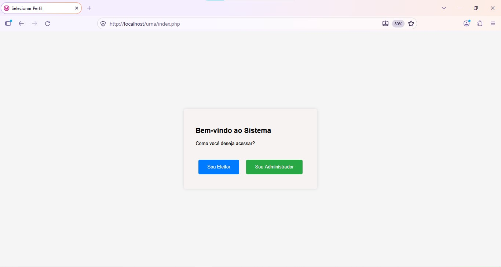
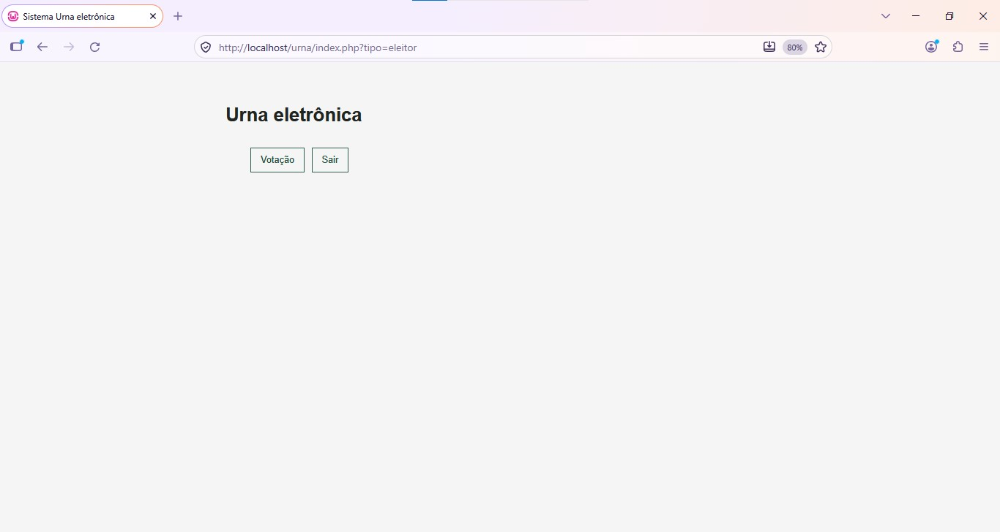
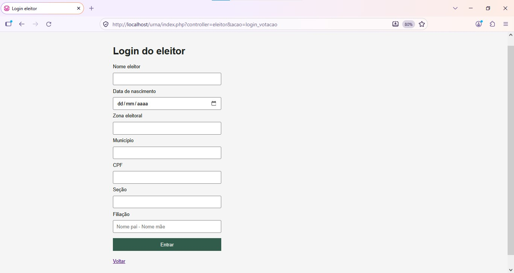
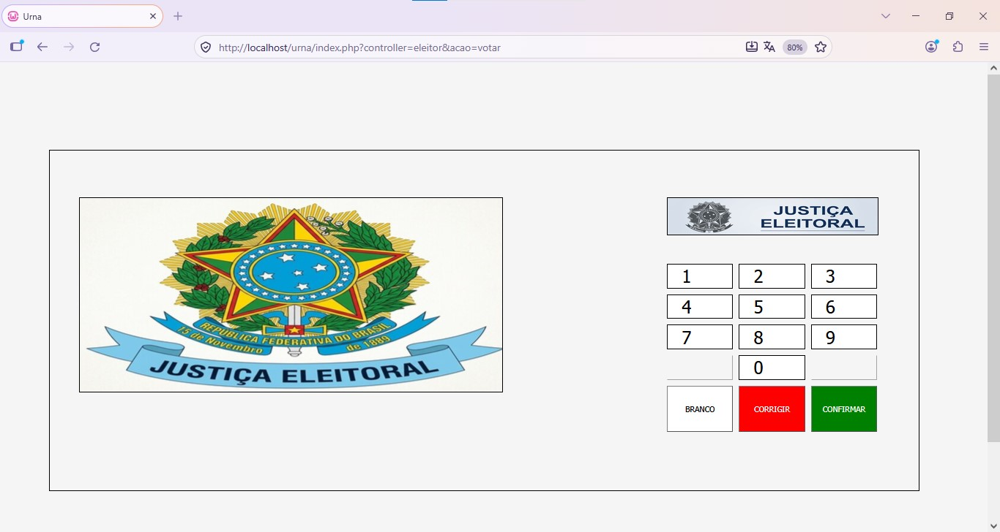

# Urna Eletrônica

Aplicação web em PHP que simula uma votação presidencial. O sistema possui duas áreas de acesso distintas: durante a votação, o eleitor pode apenas votar e não pode consultar o andamento da apuração; o administrador pode acompanhar os resultados para garantir que o sistema de votação está operando corretamente. A aplicação autentica eleitores e registra votos válidos, brancos ou nulos.

## Tecnologias

- PHP com PDO e driver PDO MySQL
- MySQL ou MariaDB
- HTML, CSS e JavaScript

## Funcionalidades

- Autenticação do eleitor por nome, data de nascimento, zona, município, CPF, seção e filiação.
- Votação em candidato usando número de dois dígitos, voto em branco ou voto nulo quando o número informado não corresponde a um candidato cadastrado.
- Bloqueio de novo voto para eleitor que já votou.
- Consulta dos totais de votos válidos, brancos e nulos, além da apuração por candidato, exclusiva do administrador autenticado.

## Telas

As imagens abaixo mostram apenas algumas páginas do sistema.

<div align="center">
   
</div>
<div align="center">
   
</div>
<div align="center">
   
</div>
<div align="center">
   
</div>

## Banco de dados

O banco padrão é `eleicoes_presidenciais`. O modelo separa os dados de cadastro dos registros de votação:

- `eleitor` guarda a identidade e os dados usados para autenticação. `idEleitor` é o identificador gerado pelo banco; `votou` começa em `0` e passa para `1` após o voto ser registrado.
- `legenda` guarda cada opção de voto: partido ou coligação, número digitado na urna e nome do candidato. `id` identifica a opção. No esquema atual, partido/coligação, número e nome do candidato têm restrição de unicidade; o número deve corresponder ao informado na urna.
- `votacao` guarda o voto confirmado. `eleitor_idEleitor` relaciona o registro ao eleitor e é único, impedindo mais de um voto por eleitor. `legenda_id` relaciona votos válidos a uma opção de `legenda`; fica `NULL` para votos brancos ou nulos. Os campos `votos_validos`, `votos_brancos` e `votos_nulos` indicam o tipo registrado: em cada voto, apenas um recebe `1` e os demais recebem `0`.

Assim, um eleitor pode ter nenhum ou um registro em `votacao`; uma opção em `legenda` pode estar relacionada a vários votos válidos. Os totais exibidos na apuração são calculados a partir dos registros de `votacao`; não devem ser cadastrados manualmente.

### Preparar os dados

O operador deve cadastrar por conta própria os eleitores aptos e as opções de voto antes de iniciar a votação. O script SQL que contém apenas a estrutura cria o banco e as tabelas, mas não fornece esses cadastros. O dump com dados em `outros/sql-consulta_sql/sql2.sql` é uma referência de desenvolvimento para comparar o esquema e orientar eventuais alterações no código; não é um mecanismo de carga dos dados da eleição.

Execute o script de estrutura em um banco vazio. Ele não migra uma estrutura existente. Depois, insira os eleitores e candidatos reais no banco. Não insira linhas em `votacao`: a aplicação cria esse registro ao confirmar cada voto e atualiza `eleitor.votou` dentro da mesma transação.

Para cadastrar um eleitor, preencha todos os campos obrigatórios. Use `votou = 0` para permitir que ele vote. A data de nascimento usa o formato `AAAA-MM-DD`; mantenha os valores no mesmo formato que será informado no login, sem espaços extras. Município, CPF e filiação são comparados com os dados cadastrados.

```sql
INSERT INTO eleitor
   (nome, `data`, zona, municipio, cpf, secao, filiacao, votou)
VALUES
   ('Nome completo', '2000-01-31', '123', 'Cidade/UF', '12345678901', '045', 'Nome responsável 1 - Nome responsável 2', 0);
```

Para cadastrar uma opção de voto, preencha `partido_coligacao`, `numero_voto` e `nome_candidato`. O campo `numero_voto` é inteiro e a urna espera dois dígitos; use números de `10` a `99` para evitar que zeros à esquerda sejam descartados.

```sql
INSERT INTO legenda (partido_coligacao, numero_voto, nome_candidato)
VALUES ('Partido ou coligação', 10, 'Nome do candidato');
```

`outros/sql-consulta_sql/Consulta.sql` contém consultas de exemplo. O modelo relacional está em `outros/sql-model/model.mwb`.

## Configuração da conexão

A conexão é configurada em `config/conexao.php`. Os valores padrão são:

- `DB_HOST`: `localhost`
- `DB_NAME`: `eleicoes_presidenciais`
- `DB_USER`: `root`
- `DB_PASSWORD`: vazio

Esses valores podem ser substituídos pelas variáveis de ambiente correspondentes. O usuário configurado precisa ter permissão para acessar o banco e gravar os votos.

## Executar localmente

1. Instale PHP com PDO MySQL e inicie o MySQL ou MariaDB.
2. Execute o script SQL que contém apenas a estrutura do banco, em uma base vazia.
3. Ajuste as variáveis de conexão, se necessário, e cadastre os eleitores e as opções de voto que serão usados na eleição.
4. Na raiz do projeto, inicie o servidor de desenvolvimento do PHP:

   ```bash
   php -S localhost:8000
   ```

5. Acesse `http://localhost:8000/`.

## Acesso administrativo

As credenciais padrão configuradas em `controller/ADM.php` são usuário `ADM` e senha `1234`. Elas não são carregadas de variáveis de ambiente. Altere o usuário e o hash de senha no controller antes de disponibilizar a aplicação fora de um ambiente local de demonstração.

## Rotas principais

- Início: `index.php?controller=adm&acao=index`
- Login administrativo: `index.php?controller=adm&acao=login_adm`
- Resultados (após autenticação): `index.php?controller=adm&acao=listar`
- Login do eleitor: `index.php?controller=eleitor&acao=login_votacao`
- Urna (após autenticação): `index.php?controller=eleitor&acao=votar`
- Registro do voto: `index.php?controller=eleitor&acao=registrar-voto` (requisição `POST` com JSON)

## Estrutura

- `config/`: conexão com o banco.
- `controller/`: roteamento e fluxos de administrador e eleitor.
- `model/`: consultas e gravações no banco.
- `view/`: páginas PHP da aplicação.
- `public/`: CSS e JavaScript.
- `outros/`: imagens, scripts SQL e modelo do banco.

As telas principais também estão disponíveis em `outros/img/`.

## Autoria

Sander Gustavo Piva
